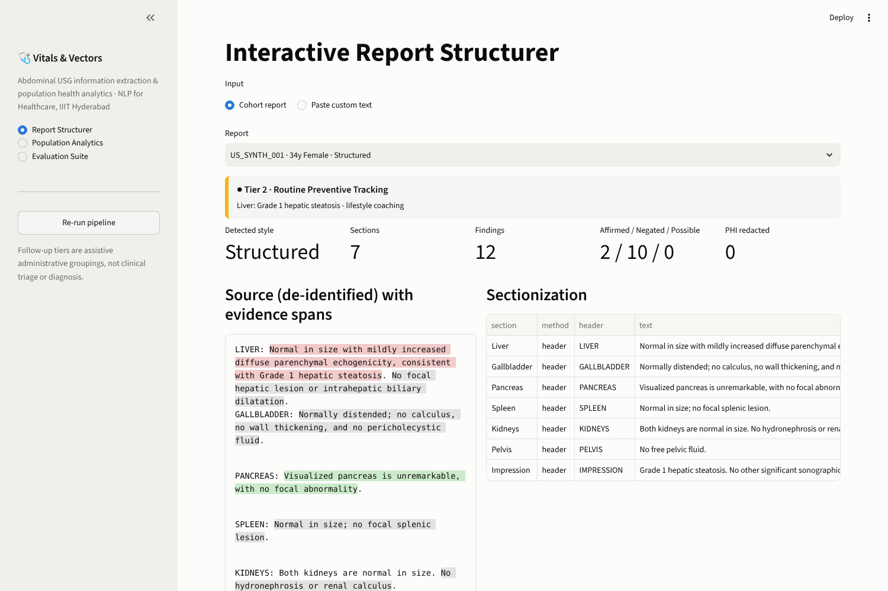
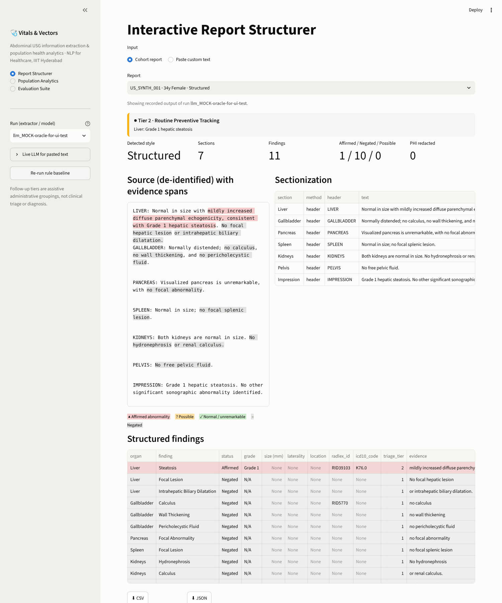
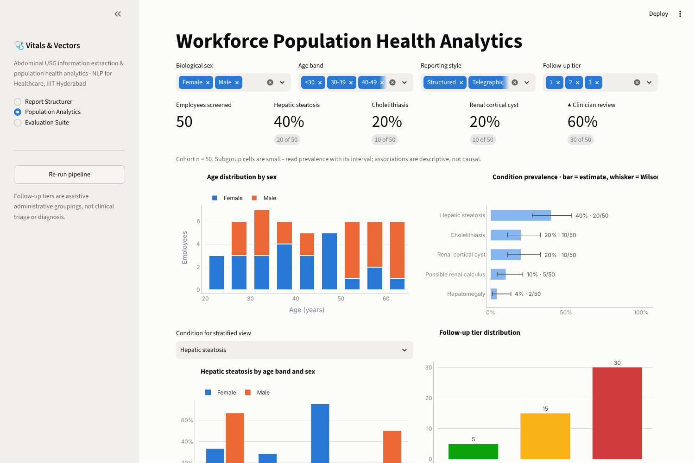
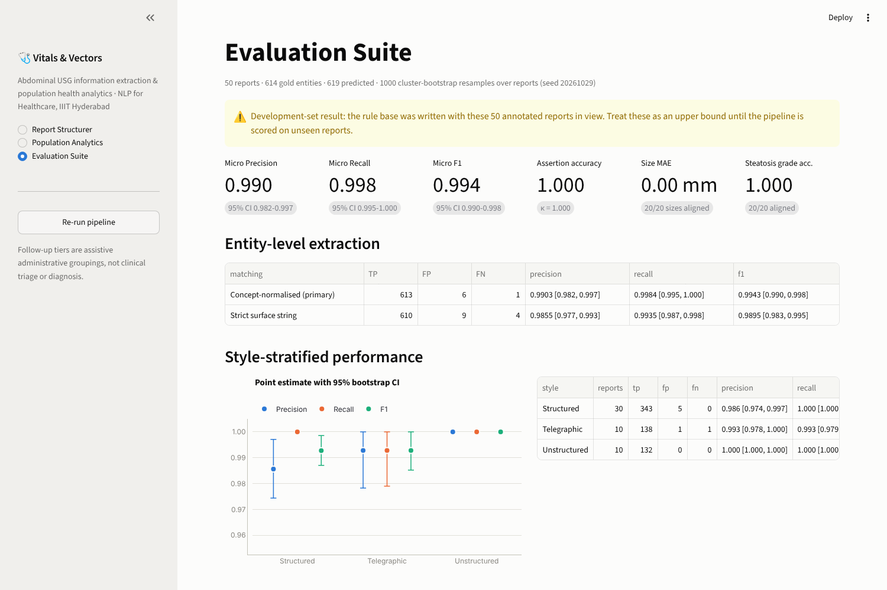

# Vitals & Vectors: Abdominal USG Report Structuring

**Course:** NLP for Healthcare (Sem 7), IIIT Hyderabad · **Team:** Dev Kanani, Kavya Bhalodi, Shivansh Santoki

This system turns free-text abdominal ultrasound reports (Structured, Telegraphic and Unstructured styles) into
validated, ontology-coded findings, a SQLite database, follow-up tiers, a benchmark and a Streamlit dashboard.
Two interchangeable extractors sit behind one interface:

| extractor | how it reads text | runs on | role |
|---|---|---|---|
| `rules` | regex gazetteer + ConText negation | CPU, ~0.1 s for 75 reports | frozen **baseline** |
| `llm` | open-weight instruction model (**Qwen 2.5 7B / Llama 3.1 8B / Mistral 7B**, ≤ 8B) filling a JSON schema, then a deterministic verifier | GPU via vLLM, or a laptop via Ollama | **generalised** system |

Why two: the rule baseline scores F1 0.994 on the 50 reports its rules were written from, but only **0.73** on
new, independently written reports (0.68 on the locked test split), because it fails on unseen wording. The LLM
extractor holds no hand-written phrase lists. Vocabulary, codes and policy come from one ontology data file, and
every model output is checked against the source text before it is stored.

```bash
pip install -r requirements.txt
python run_pipeline.py --split dev                     # rule baseline (CPU)
python -m pytest -q                                    # 52 tests, incl. mock-model LLM tests
streamlit run dashboard/app.py
```

---

## 1. Architecture

```
report.txt ──► PHIScanner (de-identify) ──► AnatomicalSectionizer (display / style)
                         │ de-identified text only ever reaches the model
                         ▼
          ┌──────────────┴───────────────┐
   RuleBasedExtractor             LLMExtractor
   (lexicon.py regex +            PromptBuilder: guideline rules + vocabulary from ontology
    ConText)                        + 3 dev-split examples (never test, never the same report)
          │                       Backend: Ollama │ OpenAI-compatible (vLLM, llama.cpp) │ transformers │ replay
          │                         + JSON-schema constrained decoding, parse-retry, response cache
          │                       FindingVerifier:
          │                         vocabulary normalisation (exact → alias → fuzzy → organ correction)
          │                         evidence grounding (exact → normalised → fuzzy) - else REJECT (hallucination)
          │                         attribute sanity (grade only steatosis; size must appear in text)
          │                         ConText cross-check → flag disagreements (not override)
          └──────────────┬───────────────┘
                         ▼
   ontology.json ──► codes (RadLex / ICD-10-CM, ICD only if Affirmed) ──► triage tiers ──► Pydantic ──► SQLite
                         ▼
   Evaluator (split-aware, v1/v2 strata, PHI, reliability) ──► outputs/<run>/ ──► dashboard / --compare
```

| path | responsibility |
|---|---|
| `usg_nlp/resources/ontology.json` | **single source of clinical knowledge**: organs + aliases, 40 finding entries (37 distinct names) with definitions, aliases, RadLex/ICD codes, triage tiers |
| `usg_nlp/ontology.py` | loader, vocabulary normalisation, code and triage lookup |
| `usg_nlp/llm/backends.py` | Ollama, OpenAI-compatible (vLLM), transformers, replay and mock backends; response cache |
| `usg_nlp/llm/prompts.py` | prompt from guideline + ontology; dev-only few-shot selection; output JSON schema |
| `usg_nlp/extractors.py` | `BaseExtractor`, `RuleBasedExtractor`, `LLMExtractor` (retry, cache, diagnostics) |
| `usg_nlp/verification.py` | evidence grounding, normalisation, attribute checks, ConText cross-check |
| `usg_nlp/extractor.py`, `lexicon.py`, `sectionizer.py`, `context.py` | rule baseline (unchanged behaviour) |
| `usg_nlp/deid.py`, `ingestion.py`, `schemas.py`, `triage.py`, `database.py`, `analytics.py` | shared stages |
| `usg_nlp/evaluation.py` | benchmark; logs every test-split evaluation |
| `run_pipeline.py` | CLI (`--extractor`, `--backend`, `--model`, `--split`, `--compare`) |
| `scripts/ada_vllm.sbatch`, `scripts/compare_models.sh` | GPU-cluster and laptop runs of all three model families |

---

## 2. Interactive Dashboard

Launch the interactive Streamlit clinical suite:

```bash
streamlit run dashboard/app.py
```

The dashboard includes 4 dedicated pages:
1. **Interactive Report Structurer:** Live sectionization, PHI redaction, source evidence highlighting, and structured findings with RadLex / ICD-10-CM / Triage badges (Figure 1 & 2).
2. **Workforce Population Health Analytics:** Demographic pyramids, condition prevalence with 95% Wilson score intervals, and triage distributions (Figure 3).
3. **Evaluation Suite:** Benchmark cards with 95% cluster-bootstrap CIs, style-stratified performance, assertion confusion matrices, and error analysis (Figure 4).
4. **Architecture & Overview:** In-depth explanation of the data flow, verification gates, and clinical triage policies.

| Interactive Report Structurer | Structured Findings Table |
|:---:|:---:|
|  |  |

| Population Health Analytics | Evaluation Suite |
|:---:|:---:|
|  |  |

---

## 3. Running the LLM extractor

The model never sees identifiers: de-identification runs first. Every response is cached in
`outputs/llm_cache/<model>.jsonl`, so a run can be **replayed exactly without the model** (for grading, the
dashboard or CI).

**Laptop (Ollama).** Expect roughly 5–8 GB RAM for a 7B Q4 model. It is slow on CPU and fine on Apple
Silicon or a GPU.
```bash
ollama pull qwen2.5:7b-instruct
python run_pipeline.py --extractor llm --backend ollama --model qwen2.5:7b-instruct --split dev
```

**GPU cluster (vLLM).** Edit the `#SBATCH` and environment lines for your account:
```bash
sbatch scripts/ada_vllm.sbatch                                        # Qwen2.5-7B-Instruct
MODEL=mistralai/Mistral-7B-Instruct-v0.3 sbatch scripts/ada_vllm.sbatch
MODEL=meta-llama/Llama-3.1-8B-Instruct HF_TOKEN=hf_... sbatch scripts/ada_vllm.sbatch   # gated: accept licence first
```

**Any OpenAI-compatible server** (llama.cpp `llama-server`, LM Studio, a running vLLM):
```bash
python run_pipeline.py --extractor llm --backend openai --base-url http://HOST:8000/v1 --model <name> --split dev
```

**Replay a recorded run, and compare runs:**
```bash
python run_pipeline.py --extractor llm --backend replay --model qwen2.5:7b-instruct --split dev
python run_pipeline.py --compare
```

Useful flags: `--few-shot 0..5` (default 3), `--no-schema` (turn off constrained decoding to measure its
effect), `--workers 8` (parallel requests to vLLM), `--retries 2`.

## 4. Data and evaluation protocol

`data/` holds 100 reports. 001–050 are the original set; 051–100 were written independently and labelled twice,
blind (see `data/DATA_README.md`).

| split | reports | use |
|---|---|---|
| `dev` | 001–075 | prompt design, few-shot pool, error analysis |
| `test` | **076–100** | **locked**: score each final system once; every evaluation is logged to `outputs/test_set_evaluations.log` |

The benchmark reports micro P/R/F1 with 95% cluster-bootstrap CIs, broken down by style and by source (v1 vs
v2 labels differ slightly; see the guideline §8). It also reports assertion accuracy and κ, size MAE, steatosis
grade accuracy, prevalence error, follow-up tier agreement and de-identification recall. For the LLM it adds
reliability numbers: proposals, rejections by reason (hallucination = ungrounded evidence, out-of-vocabulary),
unparsable reports, retries and verifier flags.

### Current results (dev split)

| run | F1 overall | F1 v1 (001–050) | F1 v2 dev (051–075) | notes |
|---|---|---|---|---|
| `rules` | 0.916 [0.885–0.946] | 0.994 | **0.725** | v1 is an upper bound (rules written on it) |
| mock oracle (gold answers) | 1.000 | 1.000 | 1.000 | plumbing check only, not a model |
| Qwen / Llama / Mistral | *run on GPU* | | | `scripts/ada_vllm.sbatch` |

The rule baseline scores 0.68 on the locked test split. That figure was measured once, for the
generalisation-gap analysis, before the LLM work began.

**What the mock-oracle test proves:** when the "model" returns the gold labels, every stage downstream
(prompt → parsing → grounding → vocabulary → codes → database → evaluator) loses nothing. Any gap a real model
shows is therefore the model's, not the pipeline's.

## 5. Current Progress & Notes for Review

- **Current Progress Completed:**
  - **Rule-Based Baseline:** Fully implemented, verified, and benchmarked on the development cohort (`dev` split, 75 reports). Achieves 0.916 micro-F1 overall (0.994 on familiar v1, 0.725 on unfamiliar v2).
  - **Corpus Expansion & Validation:** 100 abdominal ultrasound reports spanning 3 reporting styles (Structured, Telegraphic, Unstructured). High inter-annotator agreement before adjudication (F1 0.993, Cohen's $\kappa = 0.997$).
  - **Verification Pipeline:** Deterministic hallucination rejection, ontology vocabulary grounding, attribute sanity checks, and ConText cross-checks built and tested.
  - **Streamlit Clinical Suite:** 4 interactive pages (Report Structurer, Population Health Analytics, Evaluation Suite, Architecture Overview).
  - **Test Suite:** 52/52 pytest tests passing across components, pipeline, and mock-LLM integration.
- **Next Milestone (Underway):**
  - Executing open-weight instruction models (Qwen 2.5 7B, Llama 3.1 8B, Mistral 7B) on the IIIT Ada GPU cluster using `scripts/ada_vllm.sbatch`.
  - Final blind evaluation on the locked test split (`076-100`).
- **Same-family bias:** reports 051–100 were written by Claude models. The extractors are Qwen, Llama and
  Mistral, so model-family overlap is avoided, but the data is still synthetic. A small set of human-written
  test reports would strengthen the conclusions.
- **The ConText cross-check is a heuristic.** On the gold labels it disagrees in under 1% of findings, so it
  only *flags* for audit and never overrides the model.
- **Throughput:** the LLM extractor needs a GPU to process a cohort quickly. The rule baseline still meets the
  original "< 5 s on CPU" requirement and remains the fast fallback.
- RadLex and ICD codes added in v2 (ontology entries without a v1 counterpart) should be verified before
  publication.
- Follow-up tiers are assistive administrative groupings, not clinical triage or diagnosis.
